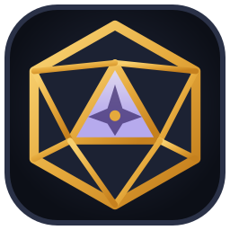

<p align="center">
  
</p>

<h1 align="center">Dice Chaos Maps</h1>

<p align="center">
  <strong>Free, Open-Source Offline TTRPG Battlemap &amp; World Atlas Cartography Studio with True 1-Inch Tabletop TV Export</strong>
</p>

<p align="center">
  <a href="https://github.com/dicechaos/DiceChaosMaps/releases"></a>
  <a href="https://github.com/dicechaos/DiceChaosMaps/actions"></a>
  <a href="https://dicechaos.com"></a>
  <a href="https://github.com/dicechaos/DiceChaosDisplay"></a>
  <a href="https://github.com/dicechaos/DiceChaosConnections"></a>
  <a href="https://github.com/dicechaos/DiceChaosMasters"></a>
  <a href="./LICENSE"></a>
</p>

---

**Dice Chaos Maps** is a free, open-source (**GPL-3.0**), offline-first TTRPG cartography studio built by **[Dice Chaos](https://dicechaos.com)** for Dungeon Masters, Game Masters, worldbuilders, and in-person tabletop groups rolling real handcrafted polyhedral dice. Paint multi-story tactical battlemaps with real-time 2D raycast lighting, subterranean basements & caverns, and **3,857 bundled clean-room CC0 assets**—or switch seamlessly into **World Atlas Studio** for hand-inked parchment continents, coastlines, and regional maps—then export at **exact 1.00-inch physical miniature scale** straight into **[Dice Chaos Display](https://github.com/dicechaos/DiceChaosDisplay)** or Universal VTT (`.dd2vtt`), with zero accounts and zero subscriptions.

> **Part of the Dice Chaos Tabletop Suite:** Built side-by-side with **[Dice Chaos Display](https://github.com/dicechaos/DiceChaosDisplay)** (4K/8K tabletop TV battlemap display with feathered Fog of War & true 1-inch physical miniature calibration), **[Dice Chaos Connections](https://github.com/dicechaos/DiceChaosConnections)** (offline TTRPG campaign mind-map, conspiracy board & zero-spoiler 2nd-screen lore display), and **[Dice Chaos Masters](https://github.com/dicechaos/DiceChaosMasters)** (free offline parametric 3D polyhedral dice master, matched insert blank & MSLA resin support CAD studio). Forge custom dice masters in *Masters*, organize your NPCs and factions in *Connections*, craft multi-story maps & world atlases in *Maps*, and run them under physical miniatures on your table TV in *Display*—or equip your party at **[dicechaos.com](https://dicechaos.com)**. Found a bug or have a feature request? [Open an issue on GitHub](https://github.com/dicechaos/DiceChaosMaps/issues).

---

## Download & Install

Grab the latest **Public Beta (`v1.0.0-beta.1`)** installers or portable packages from **[GitHub Releases](https://github.com/dicechaos/DiceChaosMaps/releases)**:

- **Windows (x64):**
  - `dice-chaos-maps-1.0.0-beta.1-setup.exe` *(NSIS installer with Start Menu & Desktop shortcuts — Recommended)*
  - `dice-chaos-maps-1.0.0-beta.1-win-x64-portable.zip` *(Self-contained portable zip — extract anywhere and run `dice-chaos-maps.exe`)*
- **macOS (Apple Silicon & Intel):**
  - `dice-chaos-maps-1.0.0-beta.1-arm64.dmg` *(Apple Silicon disk image installer)*
  - `dice-chaos-maps-1.0.0-beta.1-x64.dmg` *(Intel disk image installer)*
- **Linux (x64):**
  - `dice-chaos-maps-1.0.0-beta.1.AppImage` *(Portable AppImage)*
  - `dice-chaos-maps_1.0.0-beta.1_amd64.deb` *(Debian / Ubuntu `.deb` package)*

> **Windows SmartScreen / macOS Gatekeeper Note:** Because Public Beta builds are not yet signed with commercial code-signing certificates:
> - **Windows:** If *"Windows protected your PC"* appears on first launch, click **More info** -> **Run anyway**.
> - **macOS:** Right-click (or Control-click) the app -> **Open** on first launch.

---

## Key Features

### Dual-Mode Cartography Studio (Battlemap + World Atlas v1.5)
- **Tactical Battlemap Mode:** Photoshop-style hierarchical Layer Tree with blend modes, multi-story floor stacks (`B3`–`5F` + `ROOF` + skyship decks), onion-skin floor previews, chunked terrain brush / room flood-fill / rectangle fill, auto-mitering vector walls (straight & curved Bezier splines), wall-snapping doors/windows/archways, textured spline paths, and collision-aware Poisson-disc **Smart Scatter Zones**.
- **World Atlas Mode (v1.5):** Seamless continent & regional cartography with procedural landmass generation (`Raise / Lower / Smooth / Lake Carve`), feathered coastlines, painted biomes, meandering rivers, trade trails, political regions, curved typography labels, atlas themes (*Antique Parchment*, *Royal Atlas*, *Dark Ink*, etc.), compass roses, scale bars, sub-map detail crops, and fantasy place-name generators.

### 3,857 Bundled Clean-Room CC0 Assets + Zero-Friction Hybrid Asset Vault
- **4 Built-In CC0 Libraries Out of the Box:** Ships offline with **3,857 original CC0-1.0 assets** spanning *Modular World & Studio Harmony* (`2,083` props, architectural walls/portals/stairs, location-matched lighting fixtures, grime/weathering overlays, streetcars, outdoor theater & shops), *World Atlas Cartography* (`1,481` hand-inked watercolor symbols & paper/ocean textures), *Core Fantasy Essentials* (`170`), and *Berlin Magi-Punk Starter* (`123`).
- **Unified Asset Vault & 21 Premade Prefab Templates:** Instant fuzzy search (`/`), visual category facets, Studio Harmony filter, Biome Kits, dominant-color filtering, Favorites & Recently Used, live `dd_red` RGB recoloring with custom saved swatches, and **21 built-in multi-object Prefab Templates** (plus save your own custom room/prop prefabs!).
- **Bring Your Own Library (Read-Only In Place):** Mount loose PNG/WebP/SVG folders, `.dcpack` / `.zip` archives, or your own `.dungeondraft_pack` and Wonderdraft symbol folders locally—plus import existing `.dungeondraft_map` and `.wonderdraft_map` projects cleanly via the built-in Map Import Studio.

### Multi-Story Architecture, Caves, Water & Real-Time 2D Raycast Lighting
- **4-Mode Roof Studio (`O`):** Draw hip/gable ridge paths, box roofs, circular turrets, or 1-click Auto-Room roofs with directional sun shading and detachable `ROOF` layers.
- **5-Mode Cave & Dungeon Builder (`H`):** Carve organic caverns, rectangular dungeon chambers, polygons, and carved cave entrances with automated rocky walls, shadow rims, and multi-level subterranean basements (`B1`–`B3`).
- **4-Mode Water & Shoreline Engine (`W`):** Paint lakes, rivers, and chasms with smooth shoreline transitions, ripples, piers, and bridges.
- **Dynamic 2D Wall-Occluded Raycast Lighting (`G`):** Real-time soft shadows clipped cleanly by closed doors and walls, ambient time-of-day presets, flickering flames, spotlights, and **DM-Only Secret Note Pins (`N`)** completely stripped from Player exports.

### 4K / 8K / 16K Export Studio & `DiceChaosDisplay` Companion Pipeline
- **True 1-Inch Physical Miniature TV Calibration:** Built-in presets (`43"`, `50"`, `55"`, `65"` 4K/8K UHD — e.g. `48×27` grid on a 55" 4K TV at exact `80.11 PPI`) so exported maps drop straight into **[Dice Chaos Display](https://github.com/dicechaos/DiceChaosDisplay)** at `1.00 inch = 1 grid square` underneath physical miniatures.
- **Universal VTT & Print-Ready Tiled PDF:** Export **`.dd2vtt` / `.uvtt`** (walls, doors, windows, and lights embedded for Foundry VTT, Roll20, Owlbear Rodeo, and *Dice Chaos Display*), **1-Inch Print-Ready Tiled PDF** with cut marks and tile labels (`A1`, `B1`), or **Ultra-Res PNG / WebP / JPEG** up to 16K via tiled stitching.
- **Batch Multi-Floor & Spoiler-Free Exports:** Export Active Floor, **All Floors · Separate** (transparent upper/roof/airship PNGs for pixel-perfect re-stacking), or **All Floors · Stacked**, with automated Player vs. DM, Day/Night, and organized Folder or `.ZIP` packaging.

### 6 Built-In Interactive Showcases & Local-First Reliability
- Explore 6 ready-to-play showcases straight from the `+` tab menu: **Cathedral of the Sovereign** (9-level dark-magipunk city district `B3`–`5F` + `ROOF` with hidden caves, speakeasy, watchtower, kid theater, streetcar line & 4 multi-story shops), **Berlin Magi-Punk Funicular**, **Hidden Cove & Stolen Sloop**, **Lake Shore Sky-Yacht**, **Tro'fraderra World Atlas**, and **The Shattered Reach**.
- Crash-safe local **`.dcmap`** project files with 60-step per-tab Undo/Redo (`Ctrl+Z` / `Ctrl+Y`) and smart debounced Auto-Save (`Ctrl+S`).

---

## Quick Shortcuts

| Shortcut / Gesture | Action |
| :--- | :--- |
| **`V` · `B` / `K` / `R`** | Select & Transform · Terrain Brush / Smart Room Flood Fill / Area Rect |
| **`H` · `W` · `O`** | Cave & Dungeon Builder (`1`–`5`) · Water & Chasm (`1`–`4`) · Roof Studio (`1`–`4`) |
| **`L` · `D` · `P` · `C`** | Smart Wall · Door/Window Portal · Spline Path · Toggle Straight ↔ Curved |
| **`S` · `Z` · `G` · `N` · `M`** | Object Stamp · Smart Scatter · 2D Raycast Light · DM Note · Tactical Ruler |
| **`Q` / `E` or `Shift + Wheel`** | Rotate stamp preview, selected prop, roof sun angle, or spotlight |
| **`[` / `]` or `Alt + Wheel`** | Scale stamp, brush radius, wall thickness, portal width, or light radius |
| **`X` / `Y` · `U`** | Flip Horizontal / Vertical (or Door Swing / Hinge) · Stamp Above / Below |
| **`PageUp` / `PageDown`** | Step Up / Down building floors, roofs, and subterranean basements |
| **`Shift + S` (or Hold `Alt`)** | Toggle Grid Snapping ON / OFF (`Alt` temporarily snaps free) |
| **`/` · `F` · `Space + Drag`** | Focus Asset Vault search · Fit map to screen · Pan viewport |
| **`Ctrl + S` / `Ctrl + Shift + S`** | Save `.dcmap` (with Auto-Save) / Save As… |
| **`Ctrl + Z` / `Ctrl + Y`** | Undo / Redo (60 steps per tab) |
| **`Ctrl + E` / `Ctrl + ,` / `?`** | Open Export Studio / Preferences / Shortcuts & Dice Chaos Suite guide |

---

## Development & Building From Source

Requires **Node.js 20+** and **npm** (plus **Rust stable** for native Tauri v2 desktop builds).

```bash
# Install dependencies
npm install

# Start Vite frontend dev server (browser preview + full CC0 Vault)
npm run dev

# Start native Tauri v2 desktop studio (Rust + WebView)
npm run tauri dev

# Run TypeScript typecheck + Vitest test suite
npm run check

# Run Rust backend unit tests
cargo test --manifest-path src-tauri/Cargo.toml

# Build production web bundle & launch standalone local desktop window
npm run app:local

# Build native Tauri v2 desktop installers
npm run tauri build
```

---

## Links, Feedback & License

- **Handmade Dice & Tabletop Gear:** [dicechaos.com](https://dicechaos.com)
- **Companion 4K/8K TV Battlemap Studio:** [Dice Chaos Display](https://github.com/dicechaos/DiceChaosDisplay)
- **Companion Campaign & Conspiracy Studio:** [Dice Chaos Connections](https://github.com/dicechaos/DiceChaosConnections)
- **Companion 3D Dice Master CAD Studio:** [Dice Chaos Masters](https://github.com/dicechaos/DiceChaosMasters)
- **Bug Reports & Feature Requests:** [GitHub Issues](https://github.com/dicechaos/DiceChaosMaps/issues)
- **License:** Source code is licensed under **GNU General Public License v3.0 (GPL-3.0)** — see [LICENSE](./LICENSE). Bundled studio assets under `public/assets/*-cc0/` are dedicated **CC0-1.0**. Maps, renders, and exports you create with Dice Chaos Maps belong **100% to you** for personal or commercial publication.
